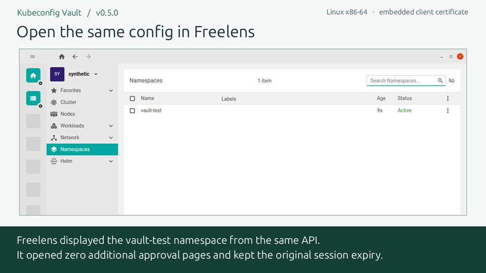

# Kubeconfig Vault

Unlock kubectl and Freelens with your YubiKey. Kubeconfig Vault encrypts your existing Kubernetes credentials and lets both clients request them through the same local helper. Your Kubernetes cluster needs no changes.

Use it on Linux or macOS with a kubeconfig that contains an inline bearer token or an embedded client certificate and private key, a verified HTTPS cluster, and a browser and security key that support WebAuthn PRF. Chrome with a USB YubiKey has been tested on Linux. Kubeconfigs that sign in through a cloud CLI or another exec plugin use a different sign-in flow. [Supported inputs](docs/INTERFACE.md#supported-kubeconfig-inputs)

<a href="docs/media/client-certificate.mp4?raw=true"></a>

[Read the transcript or see the bearer-token walkthrough](docs/DEMO.md)

## Install and set up

**1. Install the CLI.** Download the release installer and run it. It selects the binary for your OS and processor and installs it in `~/.local/bin`. The installer shows download, checksum and installation progress.

```sh
curl -fL -o install-kubeconfig-vault.sh https://github.com/mojish/kubeconfig-vault/releases/latest/download/install.sh &&
  sh install-kubeconfig-vault.sh
```

Want to try a harmless example first? Follow the [offline walkthrough](docs/README.md#try-a-sample-kubeconfig).

**2. Protect your kubeconfig.** Close any editor writing the file, connect your YubiKey, and run:

```sh
kubeconfig-vault setup
```

If the command is missing from your shell’s path, use `~/.local/bin/kubeconfig-vault setup`. Setup selects `~/.kube/config` by default. If `KUBECONFIG` lists multiple files, choose one with `kubeconfig-vault setup FILE`.

- **In the terminal**, press Enter to reveal the generated recovery key. Save it separately from the laptop. Type `verify` to check your saved copy at a hidden prompt. Anyone with this key and an encrypted backup can recover the credentials.
- **In the browser**, complete the three steps to enroll the security key, encrypt the vault, and verify it. Enter the YubiKey PIN only in the browser’s security-key dialog.

Setup puts a symlink at your usual kubeconfig path. It points to a client file containing cluster settings and a command to request credentials. An encrypted copy of your original stays beside the link so you can undo setup.

**3. Try it.** Run a read-only kubectl command that normally works for you, or reconnect in Freelens. The first request for credentials opens a local unlock page. Approve it, then repeat the request. The second request should work without another prompt. By default the session lasts one hour from approval.

## Everyday use

| When you want to… | Run |
| --- | --- |
| See whether the vault is locked or a plaintext edit is open | `kubeconfig-vault status` |
| Edit the kubeconfig in your normal editor | `kubeconfig-vault edit` |
| End the current unlock session | `kubeconfig-vault lock` |
| Make an encrypted backup of your latest save | `kubeconfig-vault backup cluster-backup.age` |

A browser page you didn’t expect can come from a background client. **Decline request** pauses automatic prompts for ten minutes. Run `kubeconfig-vault unlock` when you want to resume sooner.

## Back up and recover

Keep the encrypted backup and the recovery key in separate safe places. Run `kubeconfig-vault recover cluster-backup.age --check` to check the pair without writing a plaintext kubeconfig. For editing, recovery on a new laptop, or restoring your exact original, follow the [user guide](docs/README.md).

## Compatibility

The public v0.6.0 installer passed on Linux and macOS, on both x86-64 and ARM64. On all four platforms, real kubectl and Freelens clients shared an unlock in automated tests with a virtual security key. Physical USB YubiKey trials on Linux x86-64 cover bearer tokens and embedded client certificates. In the v0.5.1 certificate trial, Freelens initiated a physical-key unlock and kubectl reused it. Mac binaries are unnotarized. If your Mac blocks the executable, you can [build from source](docs/DEVELOPMENT.md#build-locally). Physical Mac YubiKey testing and independent security review are still open. The project is experimental.

[Tested platforms and open trials](docs/COMPATIBILITY.md) · [Compare credential workflows](docs/ALTERNATIVES.md) · [Where the keys and credentials live](docs/ARCHITECTURE.md) · [CLI reference](docs/INTERFACE.md) · [Build and test](docs/DEVELOPMENT.md) · [Report a security issue](SECURITY.md)
