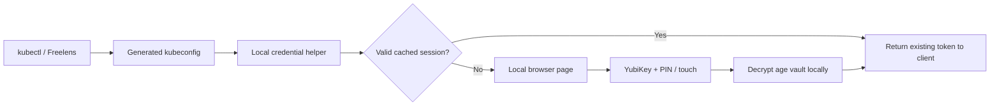

# Kubeconfig Vault

Keep your existing Kubernetes tokens encrypted on your laptop. Unlock with a
YubiKey in your browser, then use `kubectl` with a shared one-hour session.

No company login service, cluster changes, or replacement token required.
The vault and its credential helper run locally.

**Experimental.** The Linux flow has passed synthetic integration tests and a
physical USB YubiKey test. macOS cross-builds pass, while desktop browser and
hardware testing are pending. This project has not had an independent security
audit. See the [current CI results](https://github.com/mojish/kubeconfig-vault/actions).

The Go application in `age-app` builds the `kube-unlock-age` command. It uses
[age](https://github.com/FiloSottile/age) and
[Typage's WebAuthn PRF support](https://github.com/FiloSottile/typage/tree/v0.3.1).
The root `./kube-unlock` script is an older Python prototype. It is kept separately
and is not the application described below.

## How it works

1. Import a token-based kubeconfig. The helper encrypts it and creates a separate
   connection file containing the helper command instead of your tokens.
2. Point `kubectl` at that generated file. When the session is locked, a localhost
   page opens. Choose your USB security key and authenticate in the browser prompt.
3. The local helper decrypts the credentials and keeps them in memory for up to
   one hour. Subsequent requests reuse that session without another prompt.
4. Lock it yourself, let the session expire, or stop the helper to clear its cache.



The browser handles key operations; Kubernetes tokens and the private recovery
key stay in the native application. Kubernetes still checks your original token
and its existing permissions.

## What you can do

- Unlock from a browser when `kubectl` needs credentials; no terminal PIN input.
- Share one session across client processes, without extending its deadline on use.
- Edit the original kubeconfig text in your normal editor, then encrypt it again.
- Recover offline using a separate recovery key if your YubiKey is lost.
- Use a generated exec-plugin kubeconfig with compatible clients, including Freelens.

### Current compatibility

| Component | What has been checked |
| --- | --- |
| Linux + Chrome + USB YubiKey | Physical enrollment, unlock, cached access, and offline recovery using dummy data; key left connected |
| kubectl | Real client against a local synthetic HTTPS API |
| Freelens | Its Kubernetes proxy against the synthetic API; full GUI qualification for this backend is pending |
| macOS, Apple Silicon and Intel | Cross-builds pass. See CI for native test results. Desktop browser and physical-key testing are pending. |

Input currently supports **inline bearer tokens**, HTTPS clusters, public CA
certificates, and named contexts. It does not import token files, client
certificates, other exec plugins, or auth-provider configurations. See the
[input contract](docs/INTERFACE.md#age-application-contract).

## Build from source

You need Go **1.26.11+** from a supported patched release and Node.js **22.12+**.
Node is needed for building and testing, not for running the resulting binary.
Use a browser/security key combination that supports WebAuthn PRF; Chrome with a
USB YubiKey is the combination tested here. Other combinations need qualification.

From a checkout of this repository:

```sh
cd age-app
npm ci --ignore-scripts --no-audit --no-fund
npm run build:web
go build -trimpath -o kube-unlock-age .

mkdir -p "$HOME/.local/bin"
install -m 755 kube-unlock-age "$HOME/.local/bin/kube-unlock-age"
export PATH="$HOME/.local/bin:$PATH"
kube-unlock-age --help
```

Keep the executable at a stable path: generated kubeconfigs refer to its absolute
location. The app uses your default browser (`xdg-open` on Linux, `open` on macOS).
You can select a browser executable with the global `--browser` option.

Before using real credentials, run the disposable hardware test from `age-app`.
It also needs Chrome, `kubectl`, and OpenSSL:

```sh
npm run test:physical -- --keep-key-connected
```

This uses a dummy configuration and local API, and leaves the YubiKey plugged in.
See [what the test asks you to do](docs/DEVELOPMENT.md#physical-yubikey-qualification).

## Import and connect

Choose a location for your **offline recovery key**, separate from the vault.
Its parent directory must already exist. Replace the example path below with
your chosen location:

```sh
kube-unlock-age recovery-key new /path/to/offline/recovery.txt
kube-unlock-age import "$HOME/.kube/config" --recovery-key /path/to/offline/recovery.txt
kube-unlock-age status
```

Complete the numbered browser steps using your USB key. Enter its PIN only in
the browser's security-key prompt. Import verifies that both the YubiKey and the
offline key can decrypt the new vault before saving it.

**Your original kubeconfig is unchanged.** Import does not rotate the token,
replace `~/.kube/config`, or reconfigure your clients.

`status` reports the generated `kubeconfig` path. To use it, substitute that path:

```sh
kubectl --kubeconfig /path/from/status/current/kubeconfig get namespaces
```

This contacts your cluster with the existing token. Choose a permitted read
operation if listing namespaces is not allowed. After verification, you can set
`KUBECONFIG` to that file. In Freelens, add it as a synchronized kubeconfig file
reference so later saves remain visible.

Keep originals and backups until both access and recovery are verified. Those
original plaintext copies remain usable independently of the vault. Protecting
the new vault does not encrypt or delete them.

## Edit, save, and lock

```sh
kube-unlock-age config unlock
# Open the returned edit_path in your editor, save, then close the editor.
kube-unlock-age config lock
kube-unlock-age status
```

The editable file is plaintext. Disable editor backup/swap copies. Saving
validates your changes, encrypts a new generation, verifies decryption, and removes
the edit on success. Changes to cluster addresses, trust, or mappings require
`config lock --accept-connection-changes` after your review.

```sh
kube-unlock-age lock   # Clear the cached credential session.
kube-unlock-age stop   # Also stop the background helper.
```

Ordinary `lock` and `stop` **preserve unfinished edits**. `status` reports
`fully_locked: false` while plaintext edits remain. Use `config lock` to save or
`config discard` to deliberately delete unsaved edits. See the
[editing and recovery workflow](docs/DEVELOPMENT.md#age-user-operated-workflow)
for failed or interrupted saves.

## Recover without the YubiKey

Back up the vault state and keep the private recovery key offline, separately.
Anyone with both the ciphertext and that recovery key can decrypt the config.

```sh
kube-unlock-age recover /path/to/backup/vault.age --key /path/to/offline/recovery.txt --out /path/to/new-recovered-config
```

Recovery needs no browser or running helper. It writes a new **plaintext**
kubeconfig and refuses to overwrite an existing file. To replace a lost YubiKey,
import the recovered file into a new state directory and verify it before
switching clients. In-place key rotation is not implemented yet.

## Security boundaries

This protects credentials **at rest** and gates access on a trusted laptop.
It does not add server-enforced MFA to a bearer token.

- The helper releases the original token to authorized local clients. Locking
  cannot revoke tokens already cached by clients or end their existing streams.
- Same-user malware, root access, and a compromised browser are outside the
  protection boundary. A screen lock does not automatically lock this helper.
- Recovery keys, source configs, exports, editor artifacts, swap, and snapshots
  need their own protection. File deletion is not guaranteed secure erasure.
- The browser sees encryption key material, although it does not receive your
  Kubernetes token or private recovery key.
- Authentication requires user verification, but the application does not attest
  the authenticator's manufacturer. Select your intended USB security key.

Read the [design](docs/ARCHITECTURE.md) and
[implementation security review](docs/guides/age-security-review.md) before relying
on this experimental tool. The review records reproduced issues, fixes, tests,
and remaining limitations; it is not an independent audit.

## Development and documentation

- [Development and testing](docs/DEVELOPMENT.md)
- [CLI and supported kubeconfig fields](docs/INTERFACE.md)
- [Architecture and encryption flow](docs/ARCHITECTURE.md)
- [Continuous integration](docs/guides/continuous-integration.md)
- [Source map](docs/ONBOARDING.md)
- [Historical Python prototype](docs/legacy-python.md)
- [Standalone age/PRF experiment](docs/guides/age-prf-experiment.md)

Tests use synthetic credentials, isolated browser profiles, and local APIs.
Contributions should preserve those boundaries and include meaningful tests for
authentication changes. Never attach real kubeconfigs, tokens, recovery keys, or
browser authentication payloads to bug reports.

Released under the [MIT License](LICENSE).
