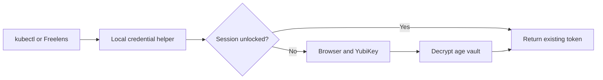

# Kubeconfig Vault

Encrypt your existing token-based kubeconfig on your laptop. When `kubectl`
needs a token, unlock the vault with your YubiKey in a local browser page.
The helper keeps the session open for up to one hour and shares it across clients.
Your cluster continues to use the same token and permissions.



The vault uses [age](https://github.com/FiloSottile/age) and
[Typage WebAuthn PRF](https://github.com/FiloSottile/typage). You can edit the
kubeconfig in your usual editor and recover it offline with a separate key.

| Platform or client | Tested coverage |
| --- | --- |
| Linux | Physical USB YubiKey in Chrome, including import, unlock, session reuse, and recovery using dummy data |
| macOS, Apple Silicon and Intel | Native builds and tests in [CI](https://github.com/mojish/kubeconfig-vault/actions). Desktop browser launch and physical YubiKey testing are pending. |
| kubectl | Real client against a local test API |
| Freelens | Kubernetes proxy against the same local API. Full GUI testing is pending. |

## Build

Use Go 1.26.11 or newer, Node.js 22.12 or newer, and a browser and security key
that support WebAuthn PRF. Chrome with a USB YubiKey is the tested combination.
Node is only needed to build the browser bundle and run tests.

```sh
cd age-app
npm ci --ignore-scripts --no-audit --no-fund
npm run build:web
go build -trimpath -o kube-unlock-age .
mkdir -p "$HOME/.local/bin"
install -m 755 kube-unlock-age "$HOME/.local/bin/kube-unlock-age"
export PATH="$HOME/.local/bin:$PATH"
```

Keep the binary at a stable path because generated kubeconfigs point to it.
Before importing real credentials, run the
[disposable hardware test](docs/DEVELOPMENT.md#test-with-a-physical-yubikey).

## Import and connect

Use a kubeconfig with **inline bearer tokens** and verified HTTPS endpoints.
See the [CLI reference](docs/INTERFACE.md) for supported fields and options.
Choose an existing directory for the offline key, separate from the vault.

```sh
kube-unlock-age recovery-key new /path/to/offline/recovery.txt
kube-unlock-age import "$HOME/.kube/config" --recovery-key /path/to/offline/recovery.txt
kube-unlock-age status
```

Complete the browser steps with your USB key. Import verifies that both keys
can decrypt the vault before saving it. Your original kubeconfig stays in place.
Copy the generated `kubeconfig` path from `status` and try a permitted read:

```sh
kubectl --kubeconfig /path/to/current/kubeconfig get namespaces
```

That command connects to your cluster. After verification, set `KUBECONFIG` to
the generated file or add it to Freelens as a synchronized file reference.

## Edit and lock

```sh
kube-unlock-age config unlock
# Open the reported edit_path, make changes, then save and close the editor.
kube-unlock-age config lock
```

The edit file is plaintext. Disable editor backups, swap, and autosave copies.
`config lock` validates, encrypts, and verifies the save before removing the
edit. Use `lock` to clear the credential session or `stop` to stop the helper.
Both preserve unfinished edits, which `status` reports as `fully_locked: false`.

## Recover offline

Back up the vault and store the private recovery key separately. Test recovery
before relying on the vault as your only copy.

```sh
kube-unlock-age recover /path/to/backup/vault.age \
  --key /path/to/offline/recovery.txt \
  --out /path/to/new-recovered-config
```

Recovery works without a browser and writes a new plaintext kubeconfig.

## Security

Kubeconfig Vault protects stored credentials on a trusted laptop. A process
running as your user, root, or a compromised browser is outside that boundary.
Kubernetes still accepts the original bearer token. Locking the helper cannot
revoke tokens already delivered to clients. Originals, offline recovery keys,
exports, and unfinished edits need their own protection.

This tool is experimental and has not had an independent security audit. See
[architecture and security boundaries](docs/ARCHITECTURE.md) for the encryption
and session design, including what the browser receives. Please keep real
kubeconfigs, tokens, and recovery keys out of bug reports.

[Development and testing](docs/DEVELOPMENT.md) · [CLI reference](docs/INTERFACE.md) · [MIT License](LICENSE)
