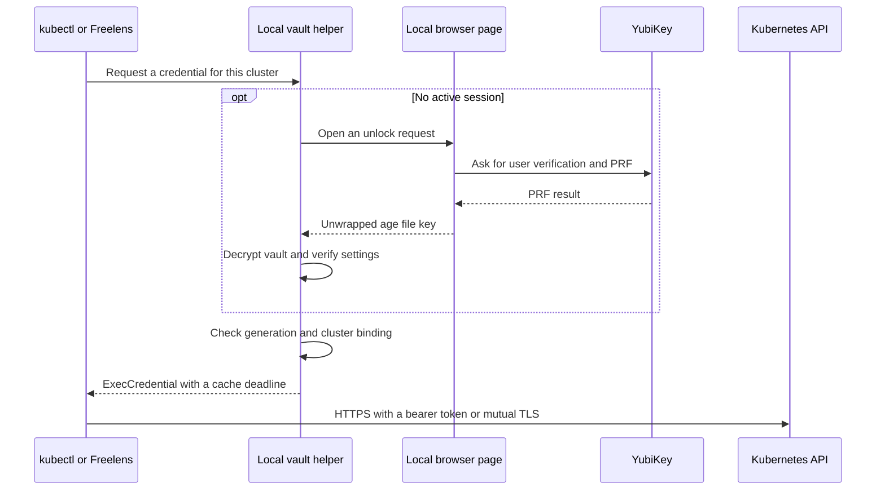

# How Kubeconfig Vault protects Kubernetes credentials

Kubernetes authenticates each user with their existing bearer token or TLS client certificate. Vault changes how the local client gets that credential. It keeps an encrypted kubeconfig on disk and supplies a credential to kubectl or Freelens after local approval. The cluster needs no identity provider, plugin, or new token.

## One Kubernetes request

The client reads an ordinary kubeconfig containing an absolute exec command, cluster settings, and credential IDs. The command talks to a helper over a Unix socket. Both ends verify the peer’s OS user. Before automatic unlock, the helper checks that the requested ID and cluster settings appear together in a context of the generated client file. This lets it reject stale clients before opening a browser. After approval it verifies the generated settings against the encrypted vault and checks the credential's authenticated cluster binding before starting the shared session. Each delivery checks the binding again.

## Where the secrets live

| Item | Where it goes |
| --- | --- |
| Kubernetes token or TLS client key | Encrypted on disk in a vault generation. The native helper handles plaintext during setup and unlock. A successful session holds credential records in memory. The helper returns either a token or a PEM certificate chain and private key to the native client. The YubiKey unlocks stored credentials. A Kubernetes client private key is exportable to the authorized client. |
| YubiKey credential | The authenticator holds the WebAuthn credential. For an approved operation, the browser uses its PRF output to wrap or unwrap an age file key. The localhost page receives encryption key material. Kubernetes credentials and the private offline recovery key stay in the native application. |
| Recovery key | During interactive setup the CLI generates and displays the private identity on the controlling terminal and passes it to the helper for verification. You choose where to keep it. The vault stores the public recipient. The optional `recovery-key new` command writes a private identity file. |
| Vault file key | age generates a fresh file key per encrypted generation. Both the WebAuthn recipient and the offline recovery recipient can unlock it. A cached credential session retains the credential records and approved settings, so it need not retain the file key. |
| Plaintext edit or export | An explicit edit writes the original YAML to a private file. An export or offline recovery writes a portable kubeconfig to the new path you choose. Each contains usable credentials. |

The Go backend uses age. The bundled browser code uses Typage for WebAuthn PRF recipient operations. The helper authenticates the age header and payload and compares the resulting metadata and connection settings before accepting an unlock. User verification is required. The ceremony does not establish an authenticator’s manufacturer.

## Browser handoff

Each ceremony gets a temporary IPv4 loopback listener, a random localhost port, a 256-bit capability, and single-use step IDs. A mode-0600 local HTML file in a private directory redirects the browser to the page. The capability travels in the URL fragment. Launcher arguments contain only the private file URI.

The helper checks the host, origin, capability header, step ID and message size. Browser assets are bundled locally. The page clears the fragment, avoids persistent browser storage, and restricts external content and framing. Cross-site top-level navigation is allowed for the redirect. The API requires the local origin. The helper removes the redirect file after the first authenticated request, launch failure, or cancellation. A forced exit can leave a private file with an expired capability.

A ceremony expires after five minutes. Locking or disconnecting the requesting client cancels it. An explicit decline of an automatic unlock pauses new prompts for ten minutes. An ordinary authentication failure after vault selection pauses them for 30 seconds. A manual unlock can retry immediately. The helper cannot reliably identify which desktop application triggered an automatic request.

## Session lifetime and its limits

The default helper session lasts one hour from approval. Both elapsed time and a wall-clock deadline limit it, including across ordinary sleep. Every delivery checks the active generation, metadata, managed client settings, cluster binding, and ciphertext file metadata. A warm request uses the in-memory credential. A cold unlock reads and decrypts the ciphertext.

The client’s own cache has a shorter deadline. Vault returns the earliest of 60 seconds from delivery, the helper’s expiry, and the credential’s expiry when available. For a client certificate it uses the leaf certificate’s expiry. For a JWT it reads the numeric `exp` claim, including fractional seconds and exponent notation. It uses that unverified claim only to shorten local access. The cluster decides whether to accept the credential. [JWT NumericDate](https://www.rfc-editor.org/rfc/rfc7519#section-2)

`lock` clears the helper’s cache. A running client can still use its delivered credential or an established connection.

This design protects a stored kubeconfig. A process running as the same OS user, a compromised browser, or a client that has received a credential can access sensitive material. WebAuthn’s localhost relying-party ID is shared across ports. Screen lock does not lock the helper automatically. Core dumps are disabled, but swap, hibernation, editor backups and filesystem snapshots remain considerations. The project awaits independent security review. [Review scope](../SECURITY.md)

## What gets written

| Path | Purpose |
| --- | --- |
| Selected client path, usually `~/.kube/config` | A symlink to `STATE/current/kubeconfig`. The target contains client settings and the exec command. Clients already using the path keep working. |
| `STATE/generations/ID/` | A private generation containing `vault.age`, public recipient metadata in `metadata.json`, and the generated client kubeconfig. `STATE/current` selects the active generation. |
| `FILE.before-kubeconfig-vault.age` and its receipt | An encrypted copy of the exact original plus a digest bound to the resolved client path. Authenticated unlink uses these to restore the pre-setup bytes. |
| `STATE/edit/kubeconfig` and, during save, `STATE/edit/saving` | Private plaintext. These can survive logout, a crash, or an ordinary lock. `status` reports known edit paths. |

Setup verifies decryption through both recipients before publishing. It checks that the source and any CA inputs still match, verifies the encrypted rollback, and replaces the source under client-go locks. Saves stage and read back the new generation before atomically switching `current`. The active and previous generations persist until authenticated pruning. A failed write can leave an unreferenced generation. A sync failure after a switch reports uncertain durability.

Unlink authenticates the original rollback with the enrolled key. It stages plaintext in a private sibling directory before replacing the client path. A process killed before the rename may leave the staged plaintext at `.kubeconfig-vault-*/client`. After syncing the restored client, unlink renames the digest receipt with a `.restored` suffix and syncs the state directory before deleting the encrypted rollback. A retry with that rollback still present checks the existing plaintext against the decrypted original and syncs the verified file descriptor. Once rollback removal is durable, a retry can remove the completion receipt without reading the client file.

An encrypted backup copies one selected generation. The age header identifies its format. `recover --check` with the backup path and private key verifies decryptability. Anyone with the public recovery recipient can encrypt to it, so the provenance of a backup matters. A full backup of the state directory can include an open plaintext edit.

## Editing and limitations

Opening an edit requires fresh authentication, even during an active session. The helper writes the original source with mode 0600 and remembers its authenticated generation, source and ciphertext digests, user IDs, and approved client settings. For an unchanged edit, it rechecks the generation and referenced CA files before cleanup. Locking or restarting the helper clears this in-memory comparison.

A changed save authenticates the old vault, validates the edited config, wraps a fresh file key, and verifies decryption through the enrolled security key. Changes to connection settings, trust, or user mappings require explicit acceptance. The helper preserves client context and namespace selections when the corresponding source selections were unchanged. Embedded CA data is limited to parsed public certificate PEM blocks.

During finalization the helper isolates the edit at `STATE/edit/saving` and compares it with the bytes used for the candidate. A concurrent change or failed verification preserves plaintext for recovery. It checks again after commit, clears the session, and syncs the edit directory before reporting successful cleanup. A file created at the original edit path during save is preserved. An editor can still write through an open descriptor, so close the editor before locking. [Recover an interrupted edit](README.md#if-a-save-is-interrupted)
