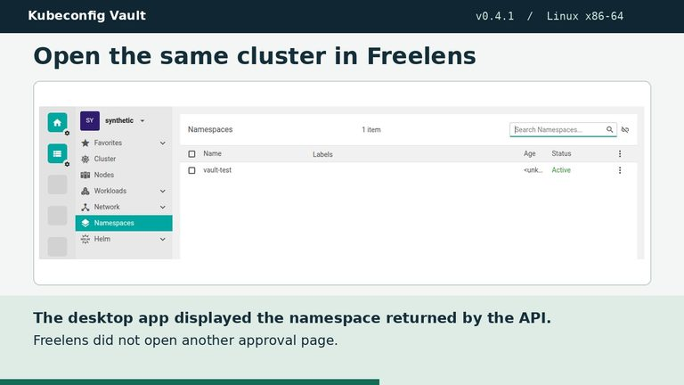

# One unlock for kubectl and Freelens

[Watch the 56-second captioned walkthrough (MP4)](media/local-unlock.mp4) · [Try the disposable sample](README.md#try-a-sample-kubeconfig)

The walkthrough uses captured application screens and measured results from two runs of the v0.4.1 source build on Linux x86-64. It used Chrome 158, a virtual CTAP2 USB authenticator with PRF, kubectl v1.36.6 and Freelens desktop 2.1.0. Its HTTPS API accepted a disposable bearer token. No physical PIN interaction is shown. The certificate workflow has a [separate test](COMPATIBILITY.md).

| Time | What happened |
| --- | --- |
| 0:00 | Setup opened the enrollment page. The helper verified that the new vault could be decrypted. |
| 0:07 | A new kubectl process requested credentials. Chrome showed the local approval page and the virtual security key completed WebAuthn. |
| 0:15 | The authenticated version request reached the disposable API, which returned `v1.32.0`. This is the fixture’s response, distinct from the kubectl version. |
| 0:22 | Freelens opened the same linked kubeconfig. Its **Namespaces** view displayed the active `vault-test` namespace. |
| 0:31 | The API recorded three authenticated namespace-list requests. The browser opened zero new approval pages. The helper reported the same expiration before and after the GUI connected. |
| 0:39 | In a separate run, locking cleared the helper session. The already-running Freelens proxy could immediately use its previously delivered token. |
| 0:48 | After a 61-second wait, the proxy requested a fresh credential. One new approval page opened and the authenticated request succeeded. |

The refresh deadline tells a cooperating client when to ask again. The API server controls the validity of a delivered credential. An open watch or shell can outlive the local session. [Lock and refresh behavior](README.md#connect-with-kubectl-or-freelens)
